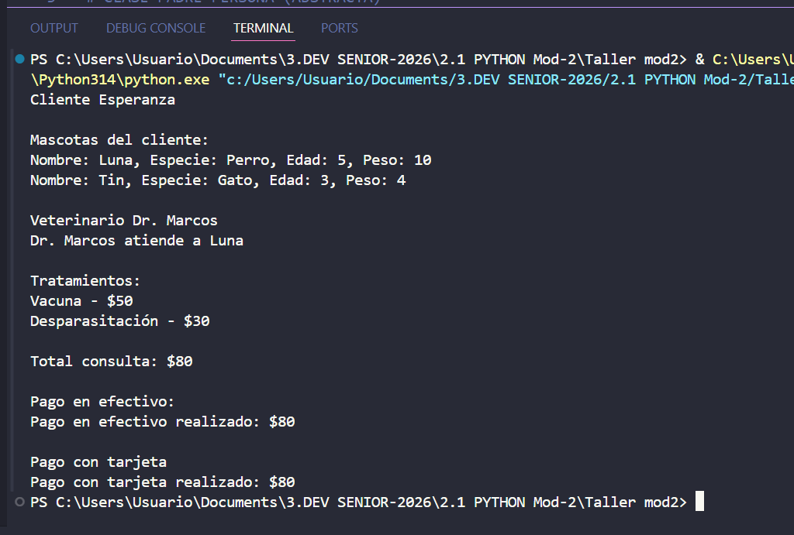

# DESCRIPCION DEL DESARROLLO DEL TALLER

El desarrollo del taller N. 2 consitia en el diseño y la implementacion de un sistema en Python que permitiera modelar el funcionamiento básico de un hospital veterinario.

Dentro del sistema se representan entidades como clientes, mascotas, veterinario, recepcionista, consultas, facturas, metodos de pago entre otros, aplicando los principios de programacion orientada a objetos POO.

1. Se definieron clases como Persona, Cliente, Veterinario, Mascota, Consulta, Tratamiento y Factura, para crear los objetos que representan los elementos reales del sistema.

2. A cada clase se le otorgaron atributos y metodos para la ejecucion de su comportamiento. Ejemplo la cosulta en relacion con el tratamiento y calculo del total

3. La herencia la vemos representada en la clase Persona respecto a Clientes, Veterinario y Recepcionista donde se usan los atributos como nombre y documento

4. La abstraccion se puede notar en la clase Metodo de pago donde se implementan las clases Pago efectivo, con tarjeta o transferencia.

5. El polimorfismo se evidencia en los diferentes metodos de pago donde cada clase implementa de forma distinata el calculo del costo total.

6. La composicion me manejo mediante la clase Consulta reflejando la relacion con el tratamiento.

FUNCIONAMIENTO

La ejecucion del sistema permite:  

* Crear un cliente
* Crear las mascotas del cliente, con atributos de nombre, especie, edad, peso
* Asignar un veterinario a una mascota
* Generar una consulta con los tratamientos y sus valores
* Calcular el costo de la consulta
* Realizar metodo de pago con diferentes metodos

UML

EJECUCION
